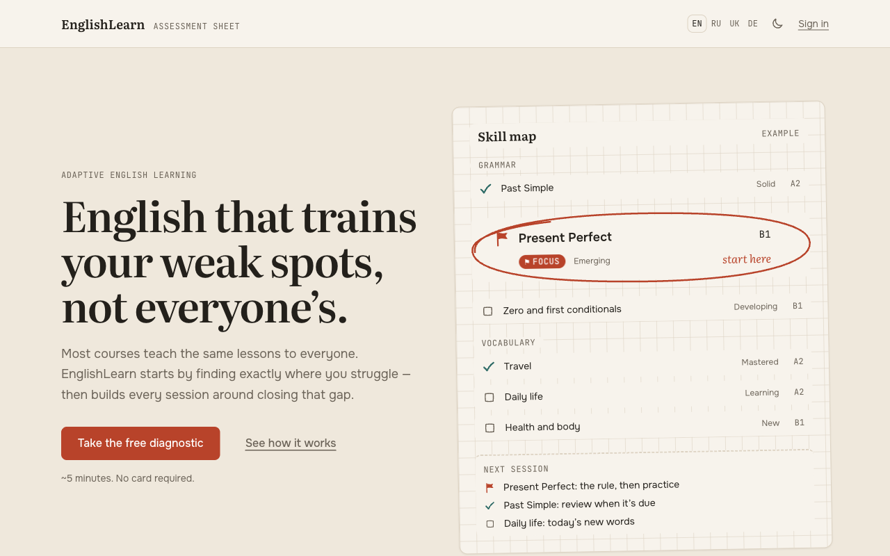
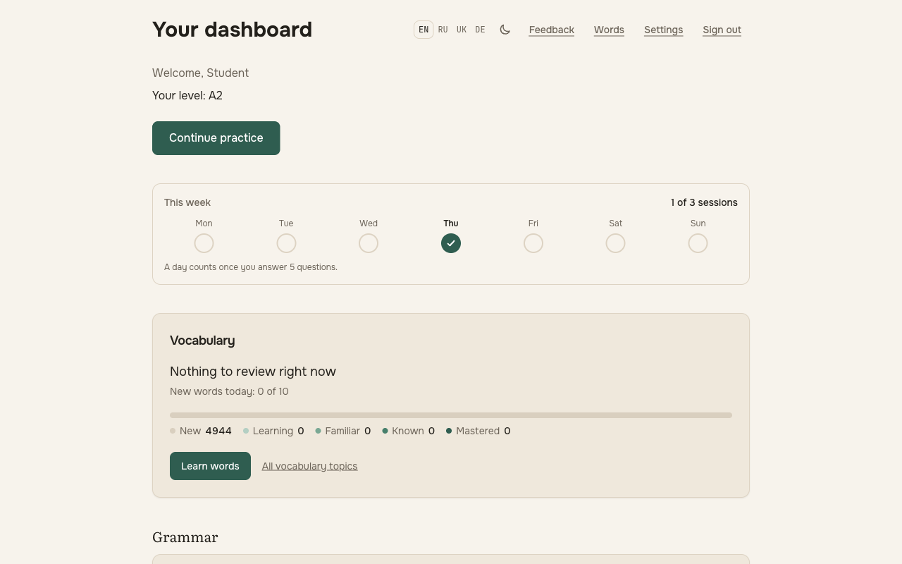
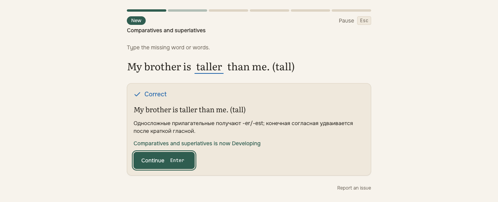
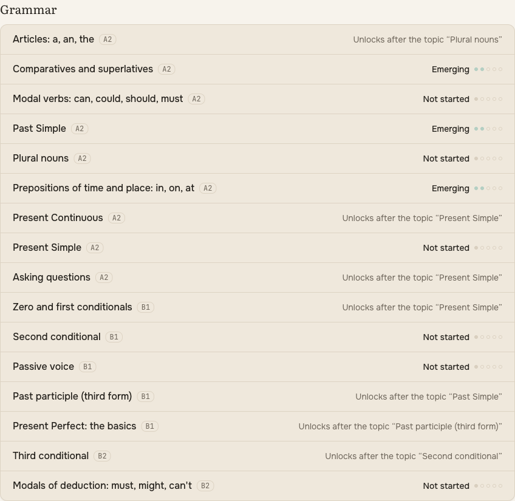
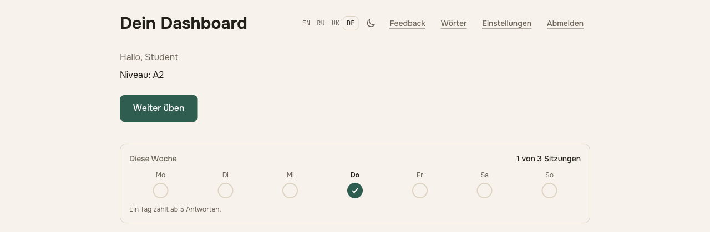
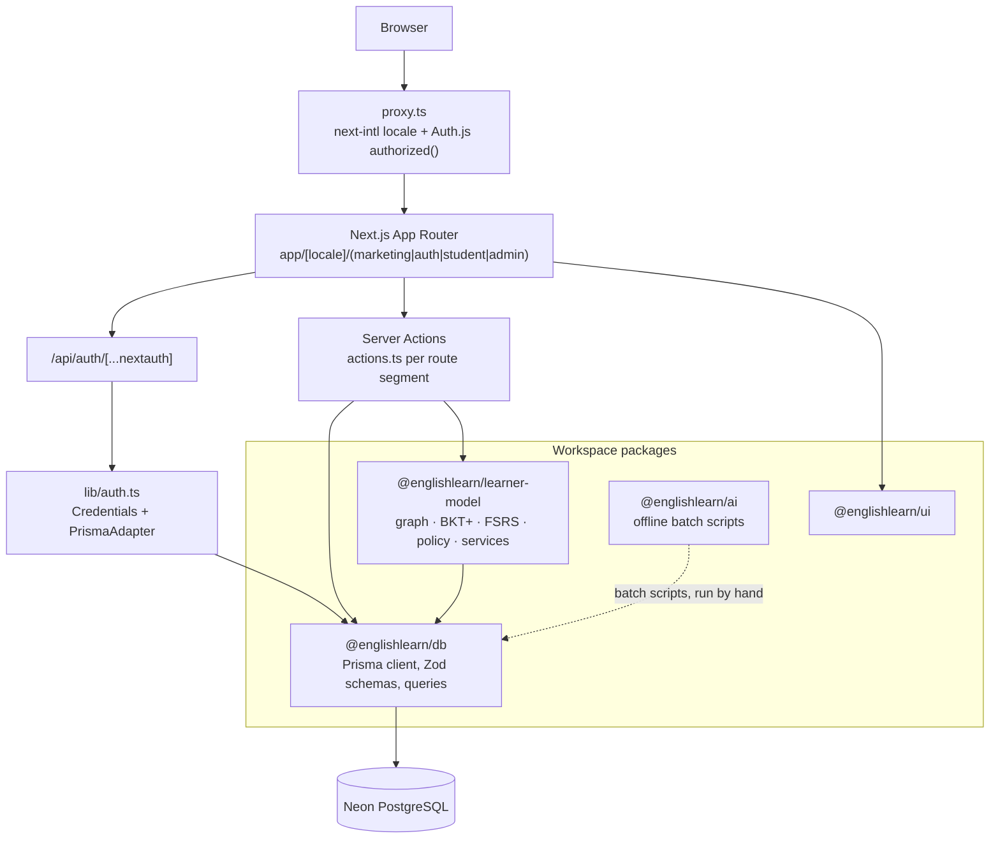
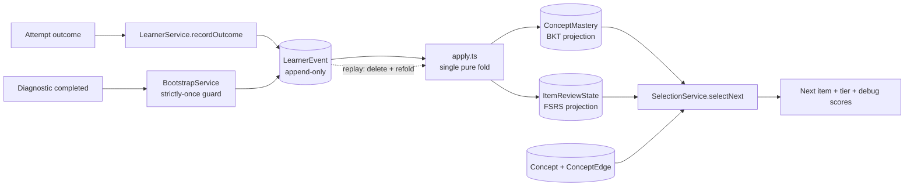
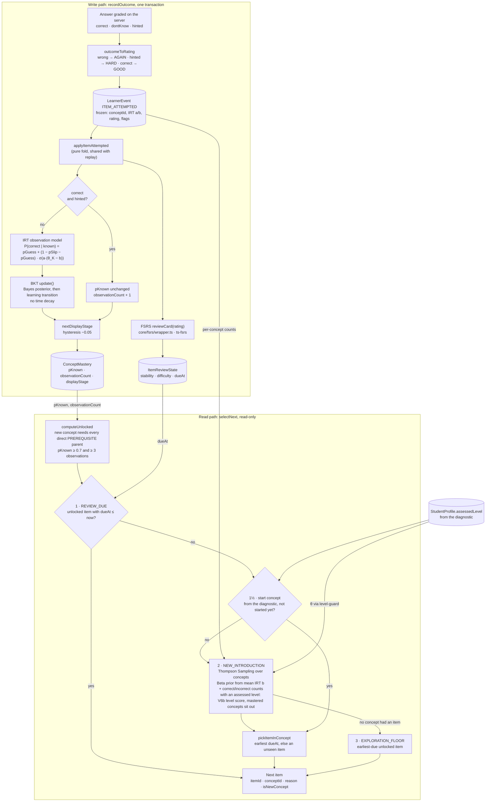

# EnglishLearn

[](https://github.com/IvanSytnik/english-learn/actions/workflows/ci.yml)
[](LICENSE)
[](https://nextjs.org)
[](https://www.typescriptlang.org)
[](https://www.prisma.io)

**Live demo:** [english-learn-web-two.vercel.app](https://english-learn-web-two.vercel.app)

Adaptive English learning platform built around an explicit, testable model of what a learner knows.

Most language apps schedule content with a single heuristic — a review queue, or a fixed syllabus. EnglishLearn separates the problem into three layers (prerequisite graph, per-concept mastery, per-item memory) and puts a bandit policy on top to decide what to show next. The learner model is implemented as a standalone, side-effect-free package with property-based tests, independent of the web app.

**Status:** pre-launch, preparing a closed beta. The beta scope is implemented and tested: placement diagnostic, adaptive grammar practice, CEFR-J vocabulary, dashboard, landing page, account self-service (password reset, data export, account deletion) and legal pages. The second iteration of the vocabulary trainer is in progress — see [Roadmap](#roadmap). The web app is deployed to Vercel and the production deployment is live, but it is not publicly launched and has no users. The diagnostic (`/diagnostic`) and the adaptive exercise player (`/exercises`) run on the learner model: the player asks `selectNext` for every question and records every answer through `recordOutcome`. Sections below mark what is implemented and what is not.

## Contents

- [Overview](#overview)
- [Key Features](#key-features) — [Implemented](#implemented) · [Not yet implemented](#not-yet-implemented)
- [Tech Stack](#tech-stack)
- [Architecture](#architecture) — [Learner model data flow](#learner-model-data-flow)
- [Project Structure](#project-structure)
- [How It Works](#how-it-works)
- [Getting Started](#getting-started)
- [Available Scripts](#available-scripts)
- [Testing](#testing)
- [Code Quality](#code-quality)
- [API / Backend](#api--backend)
- [Authentication & Authorization](#authentication--authorization)
- [Internationalization](#internationalization)
- [Engineering Decisions](#engineering-decisions)
- [Known Limitations](#known-limitations)
- [Roadmap](#roadmap)
- [License](#license)

---

## Overview

**Problem.** Adult learners (CEFR A2–C1) studying for work, immigration or travel plateau because practice is not targeted. Generic drills spend time on material already known and skip prerequisites that are actually missing.

**Approach.** Model the learner explicitly, then let a selection policy read that model:

- **Layer 3 — Knowledge Graph.** Concepts and typed edges (`PREREQUISITE`, `RELATED`, `CONTRASTS_WITH`, `PART_OF`). Prerequisite edges must form a DAG, enforced by the graph builder.
- **Layer 2 — BKT+.** Bayesian Knowledge Tracing per concept, augmented with an IRT item-response term (`σ(a·(θ − b))`, bounded by the guess and slip rates) in the observation model. The stored update applies no time decay — forgetting is Layer 1's job; exponential forgetting survives only as a read-time forecast (`predictCorrect`).
- **Layer 1 — FSRS.** Per-item memory state (stability, difficulty, due date) via `ts-fsrs`.
- **Selection policy.** Concept-level Thompson Sampling over the graph, gated by prerequisite mastery, with review-due items taking priority.

All learner state derives from an append-only event log (`LearnerEvent`). `ConceptMastery` and `ItemReviewState` are materialized projections that can be rebuilt by replaying events through the same pure fold used on the live path.

**Audience.** B2C adult learners. Tutor marketplace and payments are planned, not built.

### Screenshots

Captured from a local `next dev` against a throwaway Postgres 16 seeded the way CI seeds it, after the seeded student account took the diagnostic and one five-minute session.

| Landing | Dashboard |
| --- | --- |
|  |  |

**Exercise player.** A grammar item after a correct answer: the explanation is shown in the learner's native language, and the line under it is the learner model's semantic stage for the concept (`displayStage`), never a raw probability.



**Learner model on the dashboard.** Each grammar concept with its CEFR level and mastery stage; concepts behind an unmet `PREREQUISITE` edge show which topic unlocks them — the curriculum gate from the selection policy.



**Locale switching.** The same dashboard after choosing `DE` in the top bar (EN / RU / UK / DE).



---

## Key Features

### Implemented

- **Three-layer learner model** (`@englishlearn/learner-model`) — knowledge graph, BKT+ with IRT, FSRS wrapper. Pure functions, no I/O in the core; 796 tests in 76 files (36 of them need a real Postgres and run in CI).
- **Thompson Sampling selection policy** — concept-level bandit with an informative cold-start prior derived from IRT difficulty, hard prerequisite gating on new concepts, and a three-tier fallback (`REVIEW_DUE` → `NEW_INTRODUCTION` → `EXPLORATION_FLOOR`) that guarantees a non-empty result.
- **Event-sourced learner state** — `LearnerEvent` append-only log, single pure `apply` fold shared by the live write path and replay, one transaction and one timestamp per outcome for bit-exact reproducibility.
- **Diagnostic bootstrap** — a completed diagnostic emits `LEARNER_BOOTSTRAPPED`, mapping per-axis ability estimates to initial concept mastery. Guarded strictly-once inside the writing transaction.
- **Deterministic stochastic core** — seedable RNG (mulberry32 + Marsaglia–Tsang Beta sampler) injected at the policy boundary; `Math.random` is banned in policy code so tests and future offline evaluation are reproducible.
- **Authentication and role-based routing** — Auth.js v5, JWT sessions, credentials provider, edge-safe authorization callback protecting `/admin` and `/tutor` route prefixes.
- **Content schema layer** — Zod-validated JSON payloads for practice items, diagnostic items and vocabulary lexemes, with a source/localized split and an editorial lifecycle (`DRAFT → REVIEW → PUBLISHED → ARCHIVED`, or `REJECTED`); student-facing reads serve only `PUBLISHED` content.
- **Internationalization** — four locales (EN/RU/UK/DE) with `localePrefix: 'as-needed'` routing.
- **Placement diagnostic** — `/diagnostic`: native-language step, then 16 questions alternating grammar and vocabulary on a per-axis ladder over A2–C1. The answer key and question levels never reach the client; the result sets the learner's assessed level and the first concept to practise.
- **Adaptive exercise player** — `/exercises`: session length picker, rule cards for new grammar topics, multiple-choice and typed gap-fill (cloze) questions, a hint and "I don't know" as first-class answers, and feedback that names the concept's new stage (never a probability).
- **Vocabulary** — `/words`: 4,944 CEFR-J lexemes, localized and with examples (IPA for 4,801), imported from committed snapshots; topic collections, personal word lists and practice scheduled on FSRS card states.
- **Dashboard** — assessed level, weekly practice rhythm, vocabulary overview, and every concept with its CEFR level and mastery stage or the prerequisite that still locks it.
- **Admin** — `/admin`: content moderation, users, learner feedback; every page and action is role-checked on the server.

### Not yet implemented

- AI features in the product — `@englishlearn/ai` contains offline batch scripts only (vocabulary localization and example generation through the Anthropic SDK, run by hand); nothing in the web app calls an AI provider at runtime.
- Progress analytics dashboards, tutoring platform (the `/tutor` route prefix is reserved in the access rules, no pages exist), payments.

---

## Tech Stack

Versions are pinned centrally in `pnpm-workspace.yaml` via pnpm catalogs and referenced as `catalog:` in every workspace manifest.

| Layer | Technology | Purpose |
| --- | --- | --- |
| Framework | Next.js 16.2.9, React 19.2.7 | App Router, server components, `proxy.ts` (Next 16 replacement for middleware) |
| Language | TypeScript 6.0.3 | `moduleResolution: "Bundler"`, strict, `noUncheckedIndexedAccess` |
| Database | PostgreSQL (Neon) | Primary datastore |
| ORM | Prisma 6.16.2 + `@prisma/adapter-pg` | Schema and migrations; Rust-free client (`prisma-client` generator, `engineType = "client"`) over node-postgres |
| Auth | Auth.js v5 (`next-auth@5.0.0-beta.31`) | JWT sessions, credentials provider, Prisma adapter |
| Validation | Zod 4.4 | Content payloads, event payloads, credentials, env parsing |
| Spaced repetition | `ts-fsrs` 5.2.3 | FSRS scheduling, imported by exactly one wrapper module |
| i18n | next-intl 4.13 | Locale routing and message catalogs (en/ru/uk/de) |
| Styling | Tailwind CSS 4.3.1 | Utility styling; the current UI is functional, not final design |
| Client state | TanStack Query 5, Zustand 5 | Server-state cache and local UI state |
| Forms | React Hook Form 7.80 + `@hookform/resolvers` | Form handling with Zod resolvers |
| Env | `@t3-oss/env-nextjs` | Typed, validated environment access |
| Monitoring | Sentry (`@sentry/nextjs` 11.7) | Error tracking on server, edge and client; off without a DSN |
| LLM (offline) | Anthropic SDK (`@anthropic-ai/sdk`) | Batch vocabulary localization and example generation in `@englishlearn/ai`; not called at request time |
| Testing | Vitest 4.1.9, fast-check 3.23.2, Playwright 1.61 | Unit, property-based and end-to-end tests |
| Tooling | Turborepo 2.10, pnpm 10 (catalogs), Biome 2.5 | Task orchestration, dependency pinning, lint + format |
| CI | GitHub Actions | Lint, typecheck, test, build, and a separate Playwright job against a Postgres service container |
| Runtime | Node.js 22.x | `engines` in the root and `apps/web` `package.json` (Vercel reads the latter), plus `.nvmrc` |

---

## Architecture

A pnpm workspace with one application and five packages. Dependency direction is strictly one-way: the app depends on packages, packages never depend on the app.



The web app constructs the learner-model services in exactly one place, `lib/learner.ts`; server actions call them, never the projection tables directly. `@englishlearn/ai` is not imported by the web app — its batch scripts write vocabulary localization to the database or examples to a committed snapshot that `vocab:sync-examples` imports. See [Known Limitations](#known-limitations).

### Learner model data flow



Two properties this buys: writes go through exactly one path (no direct `UPDATE` on projections), and any user's state can be rebuilt from the log using the same code that produced it live. Replay equivalence has been verified against the live path.

#### From one answer to the next item: BKT → IRT → FSRS → selection

The same flow one level down — what `applyItemAttempted` (`service/apply.ts`) does with one graded answer, and what `selectNext` (`service/selection-service.ts` → `policy/select.ts`) reads to choose the next item. Names are the functions in `packages/learner-model` and the columns in `packages/db/prisma/schema.prisma`. The write path runs under a per-user advisory lock; every random draw on the read path goes through the seeded RNG in `policy/rng.ts`.



Two details the diagram makes visible. BKT and FSRS are deliberately decoupled: BKT's `pKnown` (conceptual acquisition) drives the prerequisite gate and the stage the learner sees, while forgetting is FSRS's job — it decides *when* an item comes back, and that wins over everything else in selection. And the IRT parameters enter twice: as the item-level observation model inside the BKT update, and as the concept's mean difficulty that sets the cold-start Beta prior for Thompson Sampling.

### Request lifecycle

`proxy.ts` composes two concerns in order — `next-intl` resolves the locale, then the Auth.js `authorized` callback decides access. The callback is deliberately kept in `lib/auth.config.ts` with an empty `providers` array so it stays edge-safe; the database adapter and credentials provider live in `lib/auth.ts`, which is only loaded in the Node.js runtime.

---

## Project Structure

```text
englishlearn/
├── apps/
│   └── web/
│       ├── app/
│       │   ├── [locale]/
│       │   │   ├── (marketing)/       # public landing
│       │   │   ├── (auth)/            # login, register (+ server action)
│       │   │   ├── (student)/         # dashboard, diagnostic, exercises, words, settings
│       │   │   └── admin/             # /admin/* — content moderation, users, ai-review, feedback
│       │   ├── api/                   # auth/[...nextauth], health
│       │   └── _components/           # top bar controls, locale switcher, theme toggle, footer
│       ├── i18n/                      # routing, request config, navigation
│       ├── lib/                       # auth.ts, auth.config.ts, env.ts, learner.ts (service wiring), diagnostic.ts, exercise/
│       ├── messages/                  # en.json, ru.json, uk.json, de.json
│       ├── scripts/                   # check-vercel-bundle.ts (pnpm check:bundle)
│       ├── tests/                     # unit (vitest) + e2e (playwright)
│       ├── proxy.ts                   # Next 16 middleware replacement
│       └── vercel.json                # Vercel project config (Root Directory = apps/web)
├── packages/
│   ├── db/
│   │   ├── prisma/                    # schema.prisma + 24 migrations
│   │   └── src/
│   │       ├── schemas/               # Zod: exercises, items, learner-events
│   │       ├── queries/
│   │       └── seed.ts
│   ├── learner-model/
│   │   ├── src/
│   │   │   ├── core/{graph,bkt,fsrs}/ # pure layers 3, 2, 1
│   │   │   ├── policy/                # Thompson Sampling, curriculum gating, RNG
│   │   │   ├── diagnostic/            # ladder, theta estimation, bootstrap mapping, start concept
│   │   │   ├── mastery/               # displayStage with hysteresis
│   │   │   ├── vocab/                 # vocabulary selection, exercise variants, paste import
│   │   │   ├── adapters/              # pure state <-> DB row
│   │   │   └── service/               # event store, apply fold, services, replay
│   │   └── seed/                      # concepts, edges, items, diagnostic bank
│   ├── ui/                            # button, card, input, key hint, stage label, progress, tokens.css
│   ├── ai/                            # offline LLM batch scripts: vocab localization, examples
│   └── config/                        # shared tsconfig presets
├── .github/workflows/ci.yml
├── turbo.json
└── pnpm-workspace.yaml                # dependency catalog
```

Key boundaries:

- **`packages/db`** is the only place Prisma is instantiated: every client — the Next.js singleton, seeds and scripts — is built by `createPrismaClient(url)` from `@englishlearn/db/create-client`, which wires in the driver adapter. It also owns the Zod schemas that validate every JSON column before it reaches the database.
- **`packages/learner-model`** contains no I/O in `core/`, `policy/`, `diagnostic/` or `adapters/`. Database access is isolated behind a `LearnerModelDb` port with a single Prisma implementation, which is what makes the service layer testable with an in-memory fake.
- **`packages/config`** holds four tsconfig presets (`base`, `library`, `nextjs`, `react-library`) that every workspace extends.

---

## How It Works

**1. Content model.** `Concept` nodes carry a CEFR level and a category. `Item` rows are atomic reviewable units attached to a concept, each carrying IRT 2PL parameters (`irtDiscrimination`, `irtDifficulty`). `Item` is deliberately distinct from `Exercise`: an exercise is a delivery vehicle, an item is the underlying fact whose memory is tracked.

**2. Cold start.** A learner completes the diagnostic. The `ThetaEstimator` interface produces a per-axis ability estimate (currently accuracy-based; an IRT 2PL implementation can replace it without touching the mapping code). `buildBootstrapSnapshots` maps ability to initial `pKnown` under a versioned formula, and emits a single `LEARNER_BOOTSTRAPPED` event carrying the full snapshot plus the constants used — so a later formula revision does not rewrite history.

**3. Selection.** `selectNext` reads the graph, mastery projections and FSRS review states, then resolves in tiers:

- items due for review are returned first;
- otherwise a concept is chosen by Thompson Sampling among concepts whose direct prerequisites exceed the mastery threshold;
- otherwise an exploration floor guarantees a non-empty response.

The Beta posterior for each concept starts from an informative prior derived from content difficulty rather than a uniform `Beta(1,1)`, which prevents erratic recommendations for a brand-new learner.

**4. Recording an outcome.** `recordOutcome` runs one transaction: insert the event, read both projections *inside* the transaction, apply the pure fold, upsert both projections with a single shared timestamp. The event payload is self-contained — it denormalizes the concept id and freezes the IRT parameters as they were at the time — so replay never depends on mutable content rows.

**5. Reward strategy.** `reward.ts` dispatches between `bernoulli`, `learning_gain` and `hybrid`. `learning_gain` is the intended target, but a calibration gate forces `bernoulli` until there are enough observations per concept to trust the parameters. Switching strategies is a configuration change, not a refactor.

---

## Getting Started

### Prerequisites

- Node.js ≥ 22 (`.nvmrc` is provided; `nvm use`)
- pnpm ≥ 10
- A PostgreSQL 16 database. Neon is what this project targets; any Postgres works locally.

### Installation

```bash
git clone <repository-url>
cd englishlearn
pnpm install
```

### Environment Variables

Copy the example file and fill it in:

```bash
cp apps/web/.env.example apps/web/.env
```

The Prisma CLI only reads `.env` from the package it runs in, so the database variables must also exist in `packages/db/.env`:

```bash
printf 'DATABASE_URL="..."\nDIRECT_URL="..."\n' > packages/db/.env
```

| Variable | Required | Description |
| --- | ---: | --- |
| `DATABASE_URL` | Yes | Postgres connection string. On Neon this is the **pooled** endpoint, used at runtime. |
| `DIRECT_URL` | For the Prisma CLI | Direct (non-pooled) connection, declared as `directUrl` in the Prisma datasource. Required for Prisma CLI commands and migrations (a connection pooler can silently drop schema changes); not used at runtime. |
| `AUTH_SECRET` | Yes | Auth.js signing secret. Generate with `openssl rand -base64 32`. |
| `AUTH_URL` | No | Auto-detected on Vercel; set explicitly when self-hosting. |
| `AUTH_TRUST_HOST` | No | Set to `true` when running `next start` locally or self-hosting; not needed on Vercel (Auth.js trusts the host automatically there). |
| `AUTH_GOOGLE_ID` | No | Reserved. Google OAuth is not wired — only the credentials provider is registered. |
| `AUTH_GOOGLE_SECRET` | No | Reserved, as above. |
| `ANTHROPIC_API_KEY` | No | Read by the Anthropic SDK in the offline `@englishlearn/ai` batch scripts (`vocab:localize`, `vocab:examples`); the web app never uses it. |
| `VOCAB_LLM_MODEL` | No | Model override for those batch scripts; a `--model` flag wins over it. |
| `OPENAI_API_KEY` | No | Reserved; declared in the env schema, not consumed by any code. |
| `SENTRY_DSN` / `NEXT_PUBLIC_SENTRY_DSN` | No | Enables Sentry on the server/edge and in the browser; without a DSN the SDK stays disabled. |
| `RESEND_API_KEY` | No | Sends password-reset email through Resend; without it the reset link is logged instead (dev, tests). |
| `EMAIL_FROM` | No | Sender address for that email; has a default. |
| `APP_URL` | No | Origin used for links in emails (never taken from the request `Host`); defaults to `http://localhost:3000`. |
| `HEALTH_TOKEN` | No | When set, the database readiness probe `/api/health?ready=1` requires it. |
| `DISABLE_RATE_LIMIT` | No | `true` turns auth rate limiting off for local e2e runs; ignored on Vercel. |
| `DIAG_DB_TEST_URL` | Tests only | Postgres for the `*.db.test.ts` suites. Point it at a throwaway database only — the tests rewrite seed rows. |
| `SKIP_ENV_VALIDATION` | No | Bypasses env schema validation. Used in CI, where a real database is not configured. |

No secrets are committed. `.env` files are gitignored; only `apps/web/.env.example` is tracked.

### Database Setup

```bash
pnpm db:generate                                    # generate the Prisma client
pnpm --filter @englishlearn/db migrate:deploy       # apply migrations
pnpm db:seed                                        # dev accounts admin@ / student@englishlearn.dev
pnpm --filter @englishlearn/learner-model seed:concepts    # 23 concepts, 18 prerequisite edges
pnpm --filter @englishlearn/learner-model seed:items       # 176 items with practice questions
pnpm --filter @englishlearn/learner-model seed:diagnostic  # 52-question diagnostic bank
```

All seeds are idempotent. The dev account passwords are in `apps/web/tests/e2e/helpers/auth.ts`.

Vocabulary for `/words`, loaded the way CI loads it — from data committed to the repository, with no API calls:

```bash
pnpm --filter @englishlearn/db vocab:import             # CEFR-J word list
pnpm --filter @englishlearn/db vocab:sync-localization
pnpm --filter @englishlearn/db vocab:publish
pnpm --filter @englishlearn/db vocab:sync-frequency
pnpm --filter @englishlearn/db vocab:sync-collections
pnpm --filter @englishlearn/db vocab:sync-examples
pnpm --filter @englishlearn/db vocab:sync-ipa
```

For a quick local run without a cloud database, a throwaway container works: `docker run --rm -d -p 55432:5432 -e POSTGRES_PASSWORD=postgres postgres:16`, then export `DATABASE_URL` and `DIRECT_URL` pointing at it before the commands above and `pnpm dev` — variables already set in the shell take precedence over the `.env` files.

Migrations are generated with `prisma migrate diff` rather than `migrate dev`, because Neon provides no shadow database:

```bash
cd packages/db
pnpm exec prisma migrate diff \
  --from-url "$DIRECT_URL" \
  --to-schema-datamodel prisma/schema.prisma \
  --script > prisma/migrations/<name>/migration.sql
pnpm exec prisma migrate deploy
```

`migrate diff --from-url` takes a raw URL and bypasses the datasource, so the direct connection string must be passed explicitly there. `migrate deploy`, `migrate status` and `db execute` read `directUrl` from the schema on their own.

### Development

```bash
pnpm dev          # Next.js dev server on http://localhost:3000
pnpm build        # production build of all workspaces
pnpm typecheck    # tsc --noEmit across every package
pnpm test         # unit + property-based tests
pnpm test:e2e     # Playwright
pnpm check        # Biome lint + format, applying fixes
```

---

## Available Scripts

| Command | Description |
| --- | --- |
| `pnpm dev` | Run the dev server via Turborepo |
| `pnpm build` | Build all workspaces (generates the Prisma client first) |
| `pnpm start` | Serve the production build (`next start`) |
| `pnpm lint` | Biome lint |
| `pnpm format` | Biome format, writing changes |
| `pnpm check` | Biome lint + format + import organization, writing changes |
| `pnpm typecheck` | `tsc --noEmit` in every package |
| `pnpm test` | Vitest across all packages |
| `pnpm test:e2e` | Playwright end-to-end tests |
| `pnpm db:generate` | Generate the Prisma client |
| `pnpm db:migrate` | `prisma migrate dev` |
| `pnpm db:push` | `prisma db push` (local prototyping only; CI applies migrations) |
| `pnpm db:seed` | Seed the dev accounts (admin, student); idempotent |
| `pnpm db:studio` | Prisma Studio |
| `pnpm clean` | Remove build artifacts and `node_modules` |

---

## Testing

Vitest for unit and property-based tests, Playwright for end-to-end. Every package defines its own `vitest.config.ts`; Turborepo runs them together.

Current counts from `vitest run` per package (tests marked *DB* need `DIAG_DB_TEST_URL` pointing at a real Postgres; CI sets it, a plain local run skips them):

| Package | Test files | Tests |
| --- | ---: | ---: |
| `@englishlearn/learner-model` | 76 | 796 (36 DB) |
| `@englishlearn/db` | 51 | 547 (170 DB) |
| `@englishlearn/web` (unit) | 73 | 1,374 |
| `@englishlearn/ai` | 8 | 70 (2 DB) |
| `@englishlearn/ui` | 7 | 24 |

Plus 19 Playwright specs in `apps/web/tests/e2e`, including a golden path from the landing page through sign-up, the diagnostic and the first exercise.

`@englishlearn/learner-model` is the substantive suite:

| Area | Files | What is covered |
| --- | --- | --- |
| Knowledge graph | `core/graph/__tests__/` | Graph construction, traversal, and property-based invariants (DAG validity, prerequisite closure) via fast-check |
| BKT+ | `core/bkt/__tests__/` | Posterior updates, IRT response term, read-time forgetting forecast, boundary behaviour |
| FSRS | `core/fsrs/__tests__/` | Scheduling wrapper, grade mapping, determinism with fuzz disabled |
| Adapters | `adapters/__tests__/` | Round-trip between pure state and database row shapes |
| Policy | `policy/__tests__/` | Seeded RNG distribution, reward strategy dispatch and calibration gating, prerequisite gating, and the no-starvation invariant of `selectNext` |
| Diagnostic | `diagnostic/__tests__/` | Ability estimation and the ability-to-mastery mapping, including floor/ceiling clamping |
| Services | `service/__tests__/` | `recordOutcome`, `selectNext` and bootstrap orchestration against an in-memory implementation of the database port |

`@englishlearn/db` — Zod schema tests for exercise content, item content and locale handling, including fast-check property tests.

`@englishlearn/ui` — component tests (Testing Library + jsdom) for `Button`, key hints, stage labels, segmented progress, the session length picker and reason chips.

`@englishlearn/web` — unit tests including the Auth.js `authorized` callback covering guest, student and admin access to public, student and admin routes; plus the Playwright specs above, with axe accessibility scans in light and dark themes.

The database port abstraction is what makes the service layer testable without a database: `LearnerModelDb` is an interface, `prisma-db.ts` is the only implementation used in production, and the test suite substitutes an in-memory fake.

---

## Code Quality

- **Biome 2.5** for lint and format. Unused variables and unused imports are errors; `any` and non-null assertions are warnings; `console` is restricted to `error`/`warn`/`info`. Import organization runs as an assist action.
- **TypeScript strict mode** with `noUncheckedIndexedAccess`, shared through four presets in `packages/config`.
- **Conventional Commits.**
- **Editor consistency** via `.editorconfig`; single quotes, 2-space indent, 100-column width, LF endings.

### CI

`.github/workflows/ci.yml` runs on pushes and pull requests to `main`. Two jobs, both against a `postgres:16` service container with a health check:

1. **`ci`** — install, generate Prisma client, apply migrations (`migrate deploy`), lint, typecheck, unit tests, build.
2. **`e2e`** — depends on `ci`; seeds the database, installs Chromium, runs Playwright, uploads the report as an artifact with 7-day retention.

### Deployment configuration

`apps/web/vercel.json` (the Vercel project's Root Directory is `apps/web`) configures a monorepo build — install and build both run from the workspace root with a `--filter` on the web app — pins functions to the `fra1` region next to Neon, and uses `npx turbo-ignore@2.10.0 @englishlearn/web` as the `ignoreCommand`, so a deploy is skipped when nothing in the web app's dependency graph changed since the last successful deployment.

Prisma runs Rust-free: the `prisma-client` generator with `engineType = "client"` emits TypeScript sources that import the query compiler as a JS module (wasm inlined as base64), and queries go through `@prisma/adapter-pg`. There is no native engine binary to ship and no filesystem lookup for the bundler to break. `next.config.ts` sets `outputFileTracingRoot` to the monorepo root and uses `outputFileTracingExcludes` to drop the non-Postgres compilers and unused engine wasm that tracing `@prisma/client/runtime` would otherwise pull in.

Before pushing changes that affect packaging (Prisma, `next.config.ts`, dependencies), verify the function bundle locally:

```bash
cd apps/web
vercel pull --yes --environment=production
SKIP_ENV_VALIDATION=1 vercel build --prod --yes
pnpm --filter @englishlearn/web check:bundle
```

`check:bundle` reads the built `register` and `api/health` functions and fails if the query compiler the client will load at runtime is not shipped.

---

## API / Backend

There is no separate API service. The backend consists of:

- **`/api/auth/[...nextauth]`** — mounts the Auth.js handlers.
- **`/api/health`** — health check.
- **Server Actions** — one `actions.ts` per route segment that mutates: `register`, `login`, `forgot-password`, `reset-password`, `settings`, `diagnostic`, `exercises` and `admin/feedback`. The diagnostic and exercise actions are where the learner-model services are called.
- **Server Components** — pages read through `@englishlearn/db` directly on the server.

Adding a general-purpose API layer was deliberately deferred: with a single Next.js consumer, server actions and server components cover the surface without an extra abstraction.

---

## Authentication & Authorization

Auth.js v5 with JWT sessions and a credentials provider. Passwords are hashed with bcrypt; `passwordHash` is nullable so OAuth-only accounts remain representable. The Prisma adapter persists `Account`, `Session` and `VerificationToken`.

The configuration is split in two on purpose:

- `lib/auth.config.ts` — edge-safe. No adapter, no providers, just the `authorized`, `jwt` and `session` callbacks. This is what `proxy.ts` imports, so route protection runs without pulling Prisma into the edge bundle.
- `lib/auth.ts` — the full instance with the Prisma adapter and the credentials provider, used by the route handler and server-side code.

Authorization is role-based (`STUDENT`, `TUTOR`, `ADMIN`) and enforced by path prefix in the `authorized` callback (the locale prefix, e.g. `/ru`, is stripped first): `/`, `/login`, `/register` and `/api/auth` are public; `/admin` requires `ADMIN`; `/tutor` requires `TUTOR` or `ADMIN`; everything else requires a session. The role is written into the JWT on sign-in and surfaced on the session, with the `next-auth` module augmented in `types/next-auth.d.ts` so `session.user.role` is typed.

---

## Internationalization

`next-intl` with four locales — English, Russian, Ukrainian, German — under `app/[locale]/` with `localePrefix: 'as-needed'`, so the default locale has no prefix. UI strings live in `messages/*.json`; no user-facing text is hardcoded.

Content localization uses a different mechanism. Exercise and item content is stored in `Json` columns validated by Zod, structured as a `source` object (locale-independent: the target lexeme, the grammar template, the audio URL) and a `localized` object keyed by locale. English is required and acts as the fallback. This keeps translations additive — a new locale is new keys, not a schema migration.

---

## Engineering Decisions

**Pure cores, isolated I/O.** The graph, BKT, FSRS and policy layers are pure functions over plain data. Database access sits behind the `LearnerModelDb` port. This is what makes property-based testing viable — fast-check can hammer the BKT update or the graph builder with thousands of generated inputs because neither touches a network.

**Event sourcing with a single fold.** Rather than updating mastery in place, outcomes are appended to `LearnerEvent` and folded into projections. Crucially the live path and the replay path call the *same* `apply` function, so replay cannot drift from production behaviour. Events carry self-contained snapshots — denormalized concept id, frozen IRT parameters — so recalculating history does not depend on content rows that may have changed since.

**Banning `Math.random` in policy code.** All stochasticity flows through an injected seedable RNG. Without this, a Thompson Sampling policy is untestable and offline evaluation is impossible. The same reasoning led to disabling FSRS fuzz.

**Informative priors over uniform.** A new learner's Beta prior is derived from the IRT difficulty of the concept's content rather than `Beta(1,1)`. A uniform prior produces essentially random first recommendations, which is a bad first session.

**Calibration gates instead of premature sophistication.** IRT parameters default to `a=1.0, b=0.0` and are not trusted until there are enough observations. Consequently the diagnostic uses an accuracy-based ability estimator rather than a full 2PL MLE — at neutral parameters the MLE degenerates to `logit(accuracy)` anyway, so the extra machinery would buy false precision. The estimator sits behind an interface so the IRT implementation can drop in later without touching the mapping code. The same pattern gates the reward strategy.

**Migrating without a shadow database.** Neon provides no shadow database, so the workflow uses `migrate diff` against the direct connection plus `migrate deploy`, rather than `migrate dev`. The direct URL matters: a connection pooler can accept DDL and silently not apply it.

**Typed columns for IRT, JSON for content.** Item parameters that the model reads on every selection are real Postgres columns with indexes. Content that is only rendered is JSON validated at the boundary by Zod. This avoids both a rigid schema for prose and unindexed math.

**pnpm catalogs.** Every dependency version is declared once in `pnpm-workspace.yaml` and referenced as `catalog:`. Six workspaces cannot drift onto different React or Zod versions.

**Prisma enum as canonical.** Where an enum needs a runtime counterpart, the Prisma enum is the source of truth and the Zod twin is named `XxxValue`/`XxxSchema` to avoid export collisions from the `db` barrel.

**Human-readable, immutable identifiers.** Concepts use dotted snake_case ids (`present_perfect.with_for_since`) and seed items use `item.<concept>.<slug>`, which makes seeding idempotent and event payloads readable during debugging.

---

## Known Limitations

Stated plainly, since they are design consequences rather than oversights:

- **Resolved — the learner model was not connected to the UI.** It now is: `@englishlearn/learner-model` is a dependency of `apps/web`, the services are constructed in `lib/learner.ts`, and the diagnostic and exercise server actions call them. Kept here so the history of this list stays readable.
- **Diagnostic bootstrap does not reach the bandit.** `LEARNER_BOOTSTRAPPED` writes `ConceptMastery.pKnown`, but `betaParamsForConcept` in `policy/posterior.ts` reads only event counts and mean item difficulty — the bootstrap signal never enters the Thompson prior. A statistical check over 2,000 samples confirmed no significant shift in selection (z ≈ −0.02). Separately, the bootstrap ceiling (0.60) sits below the prerequisite threshold (0.70), so a diagnostic alone can never open a curriculum gate. Both are documented and deferred deliberately: the weighting between diagnostic signal and observed outcomes should be tuned against real usage, not guessed. Since then the diagnostic reaches selection by a different route: the assessed level picks the start concept and, through the level guard, steers the level-aware (V6b) Thompson score — the Beta posterior itself still reads only counts and difficulty.
- **IRT parameters are uncalibrated.** All items carry neutral defaults. Meaningful calibration needs on the order of 500 outcomes per item.
- **Grammar content is demo-scale.** 23 concepts, 18 prerequisite edges, 176 practice items and a 52-question diagnostic bank. Enough to exercise the model, not enough for a real learner. (Vocabulary is larger: 4,944 CEFR-J lexemes.)
- **Per-user BKT parameters are placeholders.** `pLearn`, `pSlip` and `pGuess` use shared defaults pending calibration data.
- **Prerequisite gating checks direct parents only.** Transitivity is implicit through the recursive structure rather than computed as a closure.
- **The listening axis is inert.** Ability is estimated for it, but no seed concept carries the `LISTENING` category, so the signal currently has nowhere to go. It activates when listening concepts are added, with no code change.
- **Pinned to Prisma 6.16.2.** Prisma 7 changes `datasource.url` handling; the upgrade is deferred.
- **`@englishlearn/ai` is offline only.** It holds batch scripts on the Anthropic SDK for vocabulary localization and examples; no AI call happens at request time.
- **Observability is minimal.** The Sentry SDK (`@sentry/nextjs`) is wired for server, edge and client and stays disabled unless `SENTRY_DSN` / `NEXT_PUBLIC_SENTRY_DSN` is set. Product analytics are not set up.

---

## Roadmap

Shipped since the first version of this list:

1. ~~Adaptive exercise UI reading `selectNext`, closing the gap between the model and the application.~~ Shipped — `/exercises`.
2. ~~Diagnostic signal reaching selection.~~ Shipped by a different route than first planned: the assessed level picks the start concept and steers the level-aware Thompson score. Feeding bootstrap mastery into the Beta prior itself (`betaParamsForConcept`) stays deferred until there is real usage to tune the weighting against — see [Known Limitations](#known-limitations).
3. ~~Progress dashboard presenting semantic stages rather than raw probabilities.~~ Shipped — `/dashboard`.
4. ~~End-to-end learner flow: guest → registration → diagnostic → exercises.~~ Shipped — covered by `tests/e2e/golden-path.spec.ts`.
5. Content beyond demo scale — partly: vocabulary is 4,944 CEFR-J lexemes; grammar is still demo-scale (see [Known Limitations](#known-limitations)).
6. Error tracking and product analytics — the Sentry SDK is in place (enabled by a DSN); product analytics are not.

In progress — vocabulary trainer, second iteration. Done: frequency-ordered new words, topic collections, three examples and IPA per word, an intro card for new words, a definition-based exercise variant, per-word preferences (prioritize, hide, "I know"), personal word lists and paste import matched against the catalogue. Still to do before the beta: word audio, a word page, a runtime AI layer with an evaluation harness, AI-generated entries for words outside the catalogue (shown as unverified until an admin reviews them), a larger lexicon (B2, C1–C2 as reference) and synonyms.

Then: a closed beta, measured for two weeks before the scope of the public version is fixed.

Later: AI tutor (requires the provider strategy to be settled), offline evaluation harness for the selection policy, tutoring platform with video and a shared whiteboard, payments and subscriptions.

Where things stand today: [Implemented](#implemented) · [Not yet implemented](#not-yet-implemented) · [Known Limitations](#known-limitations).

---

## License

All rights reserved. This repository is published for review; no license to use, copy, modify or distribute is granted.

License: proprietary, view-only — see [LICENSE](LICENSE). Security reports: see [SECURITY.md](SECURITY.md).
